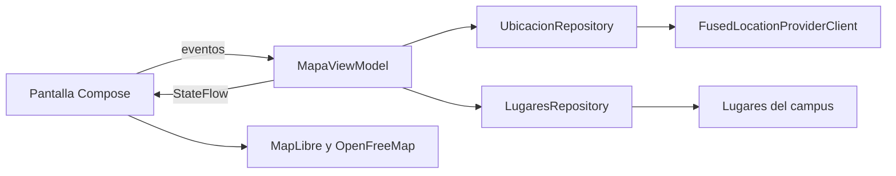
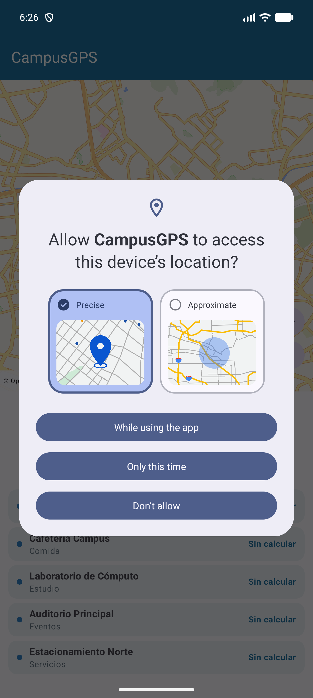
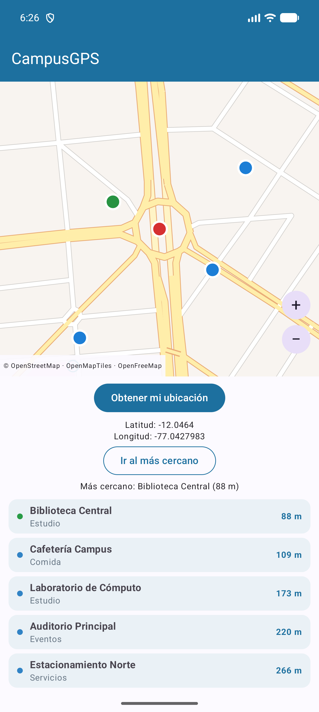
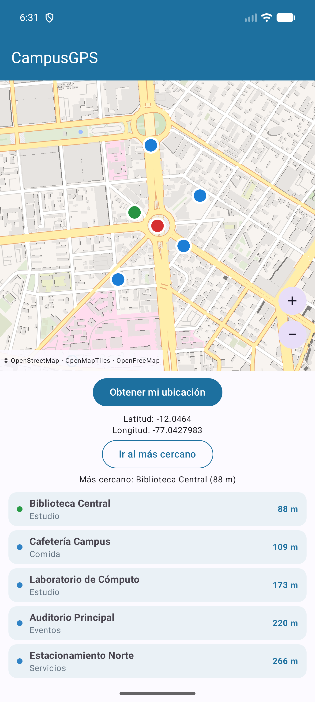
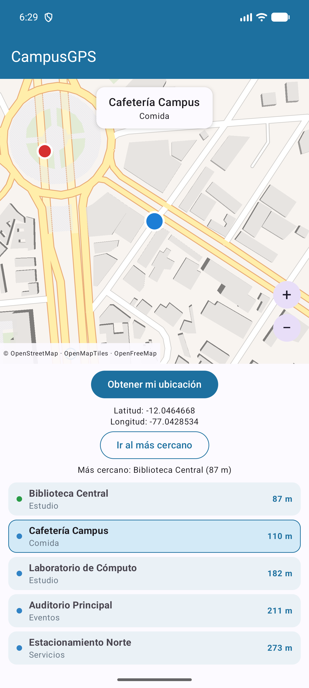
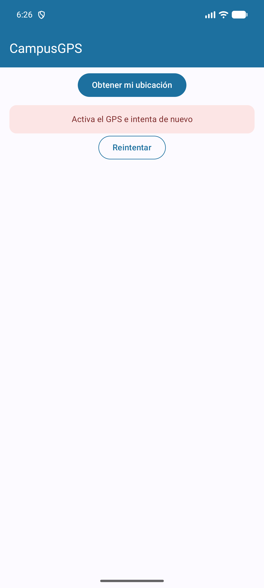

# CampusGPS

Daniella Leon · Laboratorio 13 · Fase 1

Obtiene la ubicación del dispositivo y ordena cinco lugares del campus por cercanía. Puedes tocar un marcador, seleccionar un lugar en la lista o ir directamente al más cercano.

El mapa usa MapLibre Native y OpenFreeMap, con datos de OpenStreetMap. La ubicación se obtiene con FusedLocationProviderClient.

## Ejecutar

Abre el proyecto en Android Studio, usa JDK 21 y sincroniza Gradle. Requiere Android 7.0 o superior; para compilar, Android SDK 37. El emulador debe incluir Google Play Services.

Ejecuta con Internet y pulsa **Obtener mi ubicación**. Acepta el permiso preciso o aproximado. No necesitas una clave de mapas.

Para probar los lugares de ejemplo, usa la posición `-12.0464, -77.0428` en los controles de ubicación del emulador.

```shell
./gradlew assembleDebug testDebugUnitTest lintDebug
./gradlew connectedDebugAndroidTest
```

En Windows usa `gradlew.bat`. En Mac, si es necesario, ejecuta primero `chmod +x gradlew`.

## Código

Todo está en `app/src/main/java/com/leon/campusgps/`:

| Carpeta | Contenido |
|---|---|
| `model` | Posición, lugares y estados de la pantalla |
| `data` | Interfaces de Repository, ubicación y cinco lugares de ejemplo |
| `viewmodel` | Búsqueda, selección, orden por distancia y lugar más cercano |
| `ui` | Pantalla, mapa, lista y mensajes de error |
| `util` | Cálculo y formato de las distancias |

Las dependencias están en `app/build.gradle.kts`: Material 3, Lifecycle, Play Services Location, coroutines y MapLibre Native 13.5.4.



El ViewModel no recibe Context. La Factory construye los repositorios; la pantalla observa el estado. El cálculo de distancias está fuera de los Composables.

## Capturas

Permiso de Android y ubicación obtenida:

 

Cinco lugares y selección desde un marcador:

 

GPS apagado:



En [docs/capturas](docs/capturas) también están la denegación de permiso, la selección de tarjeta, la rotación y el cambio de ubicación.

## Para pensar

**¿Por qué FusedLocationProviderClient está en Repository y no en el ViewModel?**
Porque depende de Android. La interfaz permite probar el ViewModel con posiciones controladas sin cambiar la pantalla.

**¿Qué diferencia hay entre el permiso y una clave de mapas?**
El permiso autoriza el acceso a la ubicación del usuario. Una clave identifica a la app ante un proveedor que la exige, como Google Maps. El proveedor usado aquí no requiere clave.

**¿Por qué una clave iría en local.properties y qué haría si se publica?**
Ese archivo queda fuera de Git. Si una clave se publica, hay que revocarla; borrarla en otro commit no la elimina del historial. Esta app no contiene una clave de mapas.

**¿Dónde calculo las distancias y por qué no en un Composable?**
En `util/Distancia.kt`, usando `Location.distanceBetween`. El ViewModel calcula y ordena; la pantalla solo presenta el resultado.

**¿Qué pasa si se niega dos veces el permiso?**
Android puede dejar de mostrar el diálogo. La app ofrece **Abrir ajustes** y vuelve a comprobar el permiso en cada búsqueda.

## Verificación

Compilación debug y lint sin errores, 15 pruebas unitarias y 9 instrumentadas correctas. También se hizo el recorrido en la app normal con el mapa real, permisos, GPS apagado y rotación. Detalles en [docs/VERIFICACION.md](docs/VERIFICACION.md).

Los lugares son ficticios. El color rojo indica la posición; azul, los lugares; verde, el más cercano. No hay seguimiento en segundo plano.

Datos cartográficos: © OpenStreetMap · OpenMapTiles · OpenFreeMap. [Proveedor del mapa](https://openfreemap.org/quick_start/).
