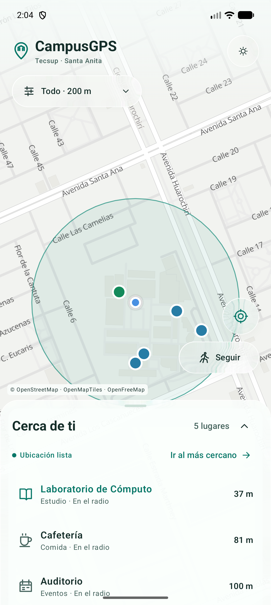
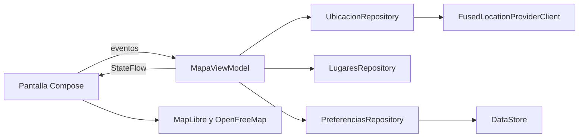
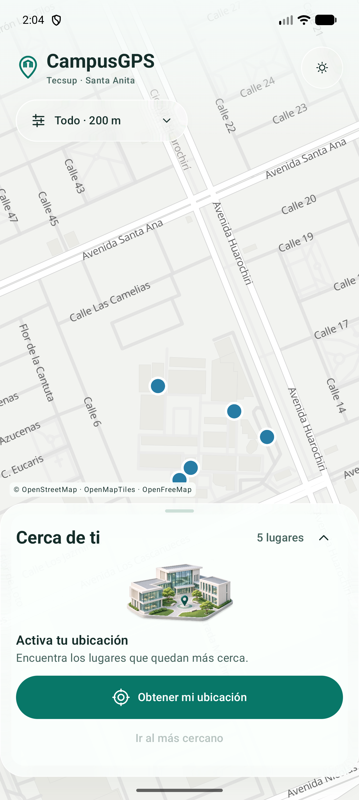
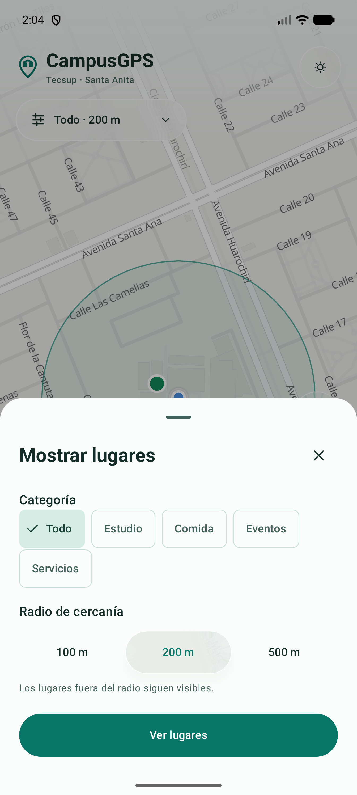
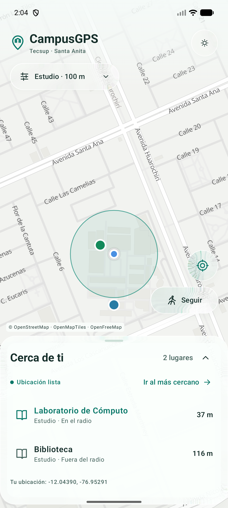
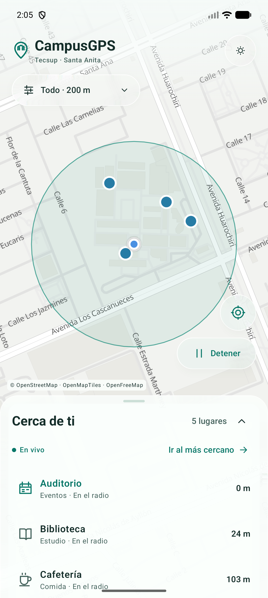
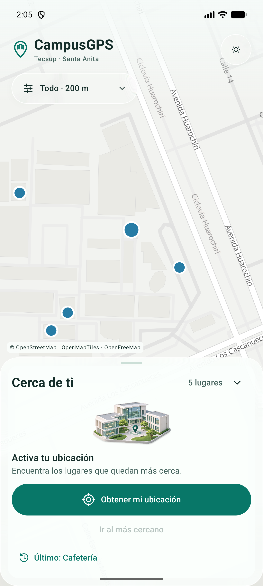
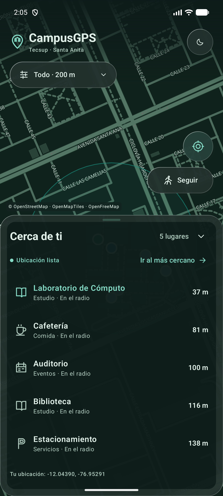

# CampusGPS

Daniella Leon · Laboratorio 13 · Fase 2

Un mapa para encontrar cinco lugares del campus y saber cuál queda más cerca. Verde agua, controles de cristal y una lista que se despliega cuando la necesitas.

La versión base está en [main](https://github.com/Daniellaln/CampusGPSLeon/tree/main). Esta rama, **mejora-ia**, conserva la base y añade las seis mejoras de la guía: categorías, radio de cercanía, punto de ubicación, seguimiento en vivo, último lugar guardado y tema oscuro.

## Antes y después

La base conserva los datos de demostración de la guía en el centro de Lima. La versión actual muestra Tecsup Santa Anita con los destinos indicados por Daniella.

 

## Usarla

Pulsa **Obtener mi ubicación** y acepta el permiso preciso o aproximado. Toca un lugar o **Ir al más cercano**. La píldora superior abre categorías y radios de 100, 200 o 500 metros; los lugares de fuera siguen visibles. Arrastra la lista o pulsa su flecha para verlos todos.

**Seguir** actualiza la posición sin repetir la búsqueda. **Detener** conserva el último punto; salir al escritorio retira las actualizaciones. La app recuerda el lugar elegido y permite recuperarlo al abrir. El botón de aspecto ofrece Claro, Oscuro o Del sistema.

El mapa está centrado en Tecsup Santa Anita y los cinco destinos usan las coordenadas facilitadas por Daniella. [Ubicaciones y procedencia](docs/CAMPUS.md). El mapa es real: MapLibre Native/OpenFreeMap con datos de OpenStreetMap. La posición llega de FusedLocationProviderClient. El punto propio es azul; el lugar más cercano, verde. Solo hay seguimiento mientras la app está abierta.

## Abrir el proyecto

Android Studio, JDK 21 y SDK 37. Requiere Android 7.0 o superior y Google Play Services para la ubicación. Sincroniza y ejecuta con Internet; este proveedor no necesita clave de mapas. En Mac, si hace falta, ejecuta `chmod +x gradlew`.

Para probar desde el centro del campus, envía `-12.0439002, -76.9529147` desde los controles de ubicación del emulador.

```shell
./gradlew assembleDebug testDebugUnitTest lintDebug
./gradlew connectedDebugAndroidTest
```

En Windows usa `gradlew.bat`. No copies `.git`, `local.properties` ni cachés de otro equipo.

## Código

Todo está en `app/src/main/java/com/leon/campusgps/`:

| Carpeta | Qué hace |
|---|---|
| `model` | Posición, lugares, categorías, tema y estados de pantalla |
| `data` | Interfaces, Fused Location, lugares de Tecsup y DataStore |
| `viewmodel` | Búsqueda, seguimiento, selección, filtros y restauración |
| `ui` | Mapa, panel nativo, lista, errores y material de cristal |
| `util` | Distancias y contorno geodésico del radio |



El ViewModel no recibe Context. La Factory crea los repositorios; Compose observa estado y envía acciones. Distancias y filtros quedan fuera de los Composables.

Las dependencias están en `app/build.gradle.kts`. La ilustración está en `drawable-nodpi` para evitar reescalado automático por densidad; los iconos vectoriales están en `drawable`. [Recursos y procedencia](docs/recursos/LEEME.md).

## Capturas de la fase 2

Inicio y filtros:

 

Radio de 100 metros y seguimiento:

 

Reapertura y tema oscuro:

 

[Todas las capturas](docs/capturas_fase2), incluido texto grande, orientación horizontal, permisos y GPS apagado.

## Para pensar

**¿Por qué FusedLocationProviderClient está en Repository y no en el ViewModel?**
Depende de Android. La interfaz permite probar el ViewModel con posiciones controladas.

**¿Qué diferencia hay entre el permiso y una clave de mapas?**
El permiso autoriza acceder a la ubicación del usuario. Una clave identifica la app ante un proveedor que la exige. El proveedor usado aquí no requiere clave.

**¿Por qué una clave iría en local.properties y qué haría si se publica?**
Ese archivo queda fuera de Git. Una clave publicada debe revocarse: borrarla en otro commit no la elimina del historial. Esta app no contiene una clave de mapas.

**¿Dónde calculo las distancias y por qué no en un Composable?**
En `util/Distancia.kt`, con `Location.distanceBetween`. El ViewModel calcula y ordena; la pantalla presenta el resultado.

**¿Qué pasa si se niega dos veces el permiso?**
Android puede dejar de mostrar el diálogo. La app ofrece **Abrir ajustes** y vuelve a comprobar el permiso al buscar.

## Comprobación y reproducción

29 pruebas unitarias y 12 instrumentadas correctas; compilación y lint sin errores. Se recorrió además la app normal con el mapa real. [Evidencia y límites](docs/VERIFICACION.md).

[PROMPTS.md](PROMPTS.md) contiene las instrucciones completas y ordenadas para Gemini y el análisis de cada cambio. [Guía del código por avance](docs/GUIA_CODIGO.md). El diseño final queda documentado en [DESIGN.md](DESIGN.md).

Datos cartográficos: © OpenStreetMap · OpenMapTiles · OpenFreeMap. [Proveedor del mapa](https://openfreemap.org/quick_start/).
